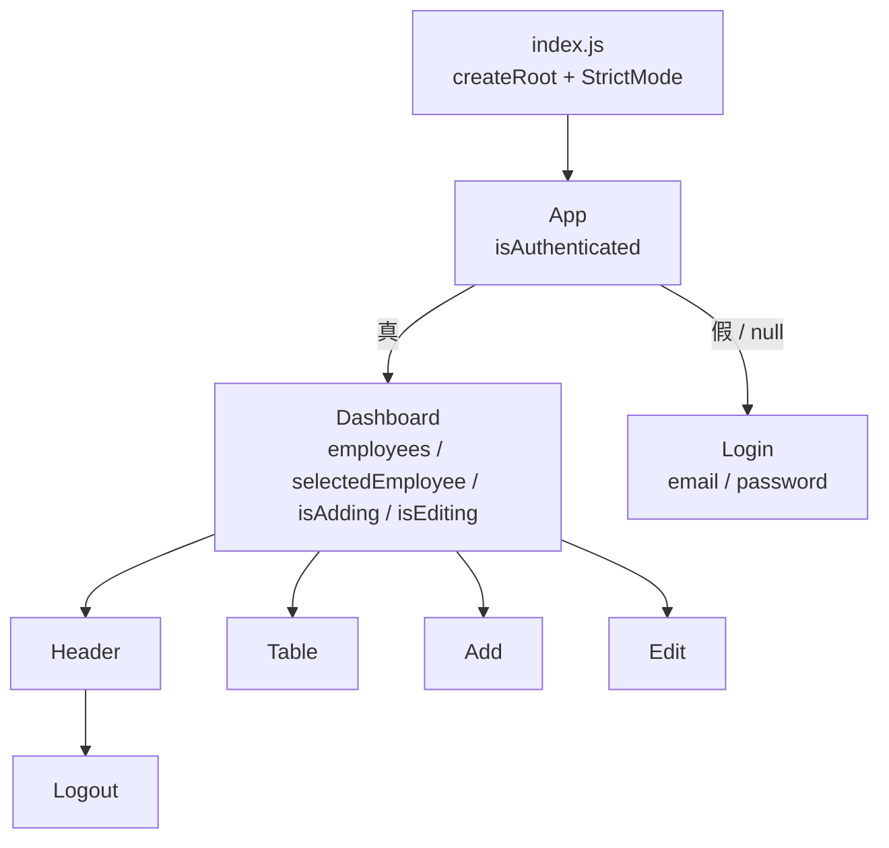
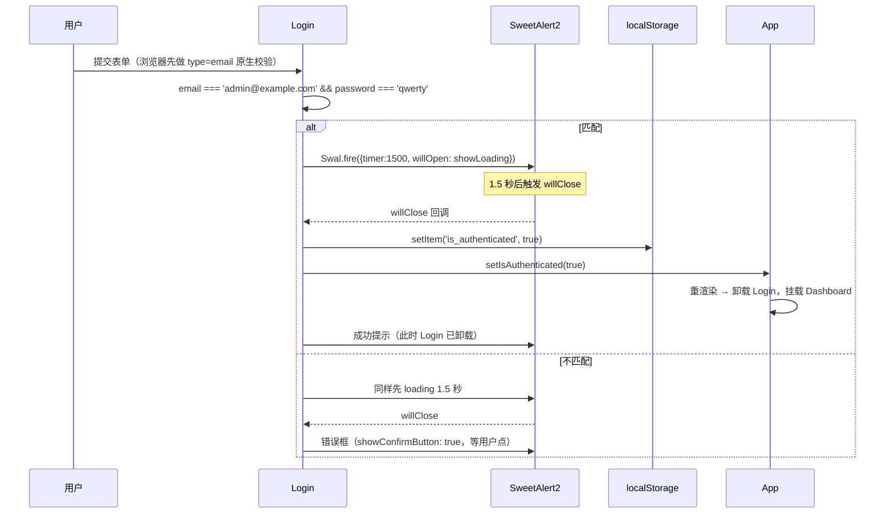
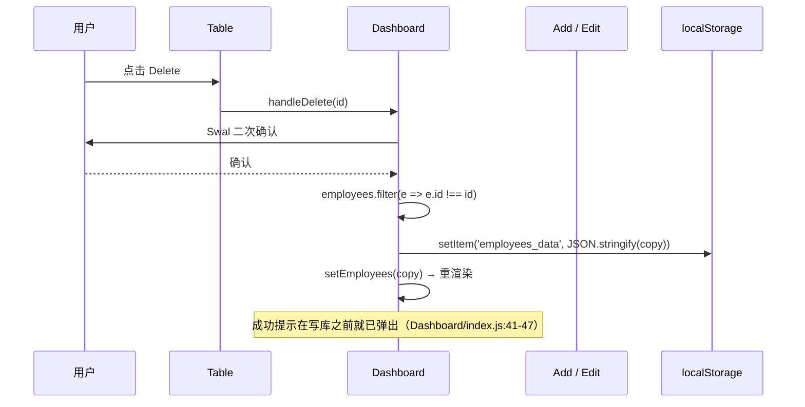

# CRUD App 源码解剖

> 对象：`crud-app` v3.3.0（React 18 + CRA 5，纯前端，无后端）
> 视角：接手、评审或准备照着它再写一版的前端开发者
> 结论所依据的实测：Node v24.22.1 下 `CI=true npx react-scripts build` 成功（JS 67.93 kB gzip / CSS 3.56 kB gzip），`CI=true npx react-scripts test --watchAll=false` 1 passed

---

## 目录

- [0. 三十秒版本](#0-三十秒版本)
- [1. 它到底解决什么问题](#1-它到底解决什么问题)
- [2. 技术路线](#2-技术路线)
- [3. 运行时结构](#3-运行时结构)
- [4. 逐文件走读](#4-逐文件走读)
- [5. 决策记录（ADR）](#5-决策记录)
- [6. 缺陷与边界行为](#6-缺陷与边界行为)
- [7. 质量与测试现状](#7-质量与测试现状)
- [8. 使用手册](#8-使用手册)
- [9. 如果这份代码还要继续长](#9-如果这份代码还要继续长)
- [10. 附录](#10-附录)

---

## 0. 三十秒版本

这份代码 644 行 JS，8 个组件，2 个 localStorage key，**0 个网络请求**。它用三个“不做”换来了极低的阅读成本：

| 不做 | 替代方案 | 代价 |
| --- | --- | --- |
| 不做路由 | `App` 里一个布尔状态切换 Login / Dashboard | 不能分享链接、刷新回到列表、无浏览器后退 |
| 不做后端 | `localStorage` 全量读写 | 无并发、无多用户、无审计、换设备即丢 |
| 不做鉴权 | 前端硬编码一组账号密码 | 任何人改 localStorage 即可进入 |

它真正值得学的是**组织方式**，不是功能：按功能切目录（`components/<Feature>/index.js`）、状态放在最近的共同祖先、所有异步反馈收敛到同一个库（SweetAlert2）、业务代码里几乎没有手写 CSS。真正不能照抄的是 **id 的生成与维护方式**——那是靠渲染顺序“碰巧”成立的。

---

## 1. 它到底解决什么问题

### 1.1 表面需求

一个“员工管理”单页应用：管理员登录后看到员工表格，能新增、编辑、删除，数据在刷新后还在。

### 1.2 隐含约束（从代码反推）

作者没有写需求文档，但代码把边界划得很清楚：

1. **只有一个用户**。没有 `userId` 字段，没有“我的数据”，登录只是一个开关。
2. **只在一台机器上**。数据存在浏览器里，没有同步、没有导出。
3. **只是演示**。登录页预填了账号密码（`Login/index.js:8-9`），删库后刷新会恢复种子数据（见 6.1）。
4. **不需要 SEO、不需要首屏、不需要离线**。CRA 的 SPA 形态足够。

这四条约束一旦成立，“无路由 + 无后端 + 无鉴权”就是**合理**选择，而不是偷懒。判断这份代码好不好，要先判断它服务的目标；把它当生产系统看，问题清单在 6 节；把它当教学样例看，它相当克制。

### 1.3 由约束推出的架构

```
浏览器
└── React 单页（CRA 打包）
    ├── App：登录态开关
    ├── Login / Logout：唯一的"身份"逻辑
    ├── Dashboard：员工数据的唯一持有者
    │   ├── Header（新增入口 + 退出）
    │   ├── Table（展示 + 行内操作）
    │   ├── Add（新增表单）
    │   └── Edit（编辑表单）
    └── localStorage：唯一的"数据库"
        ├── is_authenticated
        └── employees_data
```

没有 API 层、没有 service 层、没有 DTO。组件直接读写 `localStorage`——这是全篇最重要的一个事实：**持久化逻辑散落在 5 个组件里**（`Login`、`Logout`、`Dashboard`、`Add`、`Edit` 共 5 处写入点）。

---

## 2. 技术路线

### 2.1 依赖清单

| 依赖 | 版本 | 在系统里的角色 | 备注 |
| --- | --- | --- | --- |
| `react` / `react-dom` | ^18.2.0 | 视图层 | 用了 `createRoot`（18 的新入口），未用并发特性 |
| `react-scripts` | ^5.0.1 | 构建、开发服务器、测试、ESLint | CRA 5，webpack 5；`engines: node >=14` |
| `sweetalert2` | ^11.4.18 | **全部**交互反馈：loading、成功、错误、确认框 | 未封装，直接 `Swal.fire(...)` |
| `@testing-library/*` | ^13 / ^5.16 | 测试工具 | 只用了 `render`，`jest-dom` 在 `setupTests.js` 里注册但没写过断言 |
| `gh-pages` | ^4.0.0 | 发布到 GitHub Pages | 仅 devDependency |

`package.json` 里没有：路由、状态库、UI 组件库、请求库、表单库、TypeScript、CSS 预处理器、Prettier。这是一份**刻意保持最小**的依赖表。

### 2.2 为什么是 CRA 5

2022 年前后，CRA 仍是“零配置起一个 React 项目”的默认答案：`react-scripts start` 自带 HMR，`build` 自带压缩与 hash，`test` 自带 Jest + jsdom，`eslintConfig` 直接继承 `react-app`。对一个 8 个组件的演示项目，这比配 Vite + ESLint + Vitest 便宜得多。

代价也很明确：CRA 已停止维护，`react-scripts` 把 webpack 配置藏进依赖里，想改构建就得 `eject`（或引入 craco / react-app-rewired 之类的覆盖层）；`browserslist` 的 `caniuse-lite` 会随包老化（构建日志里已经在提示过期）。**新项目不应再选它**，但理解它为什么被选，有助于理解这份代码“零构建配置”的气质。

### 2.3 为什么没有 react-router

全应用只有两个“页面”，且第二个页面的进入条件是第一个页面的结果：

```js
// src/components/App/index.js:13-21
{isAuthenticated ? <Dashboard .../> : <Login .../>}
```

用路由要多写三样东西：`BrowserRouter`、两条 `Route`、一个“未登录跳转”的守卫；换来的 deep link 在这个场景里没有使用者。所以作者选择了**用状态代替路由**——这是全篇最典型的一个取舍：**它能成立，是因为页面少且无嵌套**。一旦出现“员工详情”“分页”“筛选条件进 URL”，这个结构会立刻变成负担。

### 2.4 为什么没有 Redux / Context

需要跨组件共享的状态只有两个：`isAuthenticated`（App 持有）和 `employees`（Dashboard 持有）。其余全是表单局部状态。用 Context 或 Redux 都属于“为了共享而共享”。作者用了最朴素的 **props drilling**：

- `setIsAuthenticated` 从 App 传给 Dashboard，再传给 Header，再传给 Logout —— **三层**。
- `employees` 从 Dashboard 传给 Table / Add / Edit —— **两层**。

三层是 props drilling 的常见警戒线。作者踩在线内，但这正是将来加路由/加用户菜单时最先要重构的地方。

### 2.5 为什么 SweetAlert2 承担了全部反馈

系统里没有任何 toast / modal / spinner 组件，所有反馈都是 `Swal.fire`：

- 登录/退出的 1.5 秒伪 loading（`willOpen: () => Swal.showLoading()`）
- 成功提示（`timer: 1500, showConfirmButton: false`）
- 删除前的二次确认（`showCancelButton: true`）
- 字段校验失败的错误框（必须手动关闭）

好处：**一种反馈只有一种写法**，没有自研组件的样式分裂；坏处：`Swal` 是命令式 API，弹窗的打开/关闭顺序就是业务时序（见 3.3），而且 sweetalert2 本身也进了首屏 bundle（整包 JS gzip 67.93 kB）。**这是一种“用依赖换一致性”的典型交易。**

### 2.6 为什么 CSS 是 1135 行的“编译产物”

`src/index.css` 开头是 Primitive UI 的版权头，文件末尾还有一段内联的 `sourceMappingURL`（base64），解码后能看到原始的 SCSS 结构：`base/_normalize.scss`、`components/_buttons.scss`、`components/_forms.scss`、`components/_tables.scss`……

也就是说：作者**没有把 Primitive UI 作为 npm 依赖引入，而是把它 Sass 编译后的 CSS 整包粘进了项目**。这解释了为什么：

- 项目里没有 `sass` 依赖，却能享受一套成体系的样式；
- 1135 行 CSS 里 95% 的类名项目根本没用（`.medium-container`、`.flex-row`、`pre`、`kbd`……）；
- 想改主题色只能改这段“外来代码”，而不是改变量。

实际用到的类只有 9 个：`.container` / `.small-container` / `.contain-table` / `.striped-table` / `.muted-button` / `.button` / `.text-center` / `.text-right` / `.text-left`。

### 2.7 目录约定

```
src/
├── index.js                 # 入口：createRoot + StrictMode
├── index.css                # 全局样式（Primitive UI 编译产物）
├── setupTests.js            # 注册 jest-dom
├── data/index.js            # 种子数据（10 条）
└── components/
    ├── App/index.js         # 登录网关
    ├── App/index.test.js    # 唯一的测试
    ├── Login/index.js
    ├── Logout/index.js
    └── Dashboard/
        ├── index.js         # 数据与视图状态的中枢
        ├── Header.js
        ├── Table.js
        ├── Add.js
        └── Edit.js
```

两点约定值得注意：

1. **每个组件目录下用 `index.js` 作为导出入口**（`components/Login/index.js`），所以 `import Login from '../Login'` 能成立。这是 barrel 风格的轻量版，好处是引用路径短，坏处是同名文件在编辑器里难区分。
2. `Dashboard` 是唯一一个“目录 + 子文件”的功能模块，因为它是唯一有内部结构的模块。**目录结构直接反映了复杂度分布**。

### 2.8 构建与发布链路

```
npm start ──► react-scripts start ──► webpack-dev-server :3000
npm run build ──► build/（static/js/main.<hash>.js, static/css/main.<hash>.css）
npm run deploy ──► predeploy(build) ──► gh-pages -d build ──► gh-pages 分支
```

关键在 `package.json` 的 `homepage`：

```json
"homepage": "https://safdarjamal.github.io/crud-app/"
```

CRA 会用它同时决定 **publicPath** 和资源 URL。实测构建日志明确写出：

```
The project was built assuming it is hosted at /crud-app/.
```

所以产物里的 `<script src="/crud-app/static/js/main.xxx.js">` 是硬编码的。**把它部署到根域、或换一个仓库名，必定白屏**——这是接手后第一个会踩的坑（修法见 8.4）。

CI 在 `.github/workflows/`：`npm ci` → `npm run build --if-present` → `npm test`，矩阵 `node-version: [12.x, 14.x, 16.x]`。三个版本全部 EOL；其中 12.x 还低于 `react-scripts@5` 声明的 `>=14`，且仓库的 `package-lock.json` 是 `lockfileVersion: 2`（npm 7+ 生成），Node 12 自带的 npm 6 与之不匹配。**这条流水线里的 12.x 一档基本注定失败**，接手时应当直接把矩阵换成 `[20.x, 22.x]`。

---

## 3. 运行时结构

### 3.1 组件树



一条容易忽略的细节：`App` 的初始值是 `null` 而不是 `false`（`App/index.js:7`）。

```js
const [isAuthenticated, setIsAuthenticated] = useState(null);
useEffect(() => { setIsAuthenticated(JSON.parse(localStorage.getItem('is_authenticated'))); }, []);
```

由于首帧 `null` 为假，**已登录用户刷新页面时会先看到一帧登录表单**，effect 跑完才切到 Dashboard。这是“用 effect 做同步初始化”的典型副作用；把 `localStorage` 读取放进 `useState` 的惰性初始化（`useState(() => JSON.parse(...))`）就没有这一帧。`StrictMode` 下 effect 会双跑，但因为只是读，幂等，没有危害。

### 3.2 状态所有权

| 状态 | 持有者 | 初值 | 修改者 | 持久化 |
| --- | --- | --- | --- | --- |
| `isAuthenticated` | `App` | `null` | Login / Logout（经 props 回调） | `is_authenticated` |
| `employees` | `Dashboard` | `employeesData`（模块常量） | Add / Edit / Delete | `employees_data` |
| `selectedEmployee` | `Dashboard` | `null` | `handleEdit` | 否 |
| `isAdding` | `Dashboard` | `false` | Header（开）、Add（关） | 否 |
| `isEditing` | `Dashboard` | `false` | `handleEdit`（开）、Edit（关） | 否 |
| 表单字段 | Add / Edit 自身 | `''` / `selectedEmployee` 字段 | 各自 `onChange` | 否 |

这张表解释了很多行为：**“当前在哪一屏”完全由两个布尔量决定**（`isAdding`、`isEditing`），而不是由路由或枚举状态机决定。于是二者同时为真在类型上完全合法；当前靠 `Dashboard/index.js:58` 的 `{!isAdding && !isEditing && (...)}` 保证互斥，而不是靠状态本身。

### 3.3 登录时序



三个实现事实：

1. **凭据比较是字符串全等**，且账号密码以字面量写在组件体内（`Login/index.js:5-6`），会被打进 bundle。
2. **登录成功不是“设置状态”，而是“在一个弹窗关闭回调里设置状态”**。`willClose` 触发时 `Swal` 的 DOM 正在销毁，紧接着又 `Swal.fire` 一个成功提示——两段弹窗生命周期首尾相接。这种写法能用，但对时序极其敏感。
3. **失败路径也故意等 1.5 秒**，模拟“正在验证”。真实系统里这是反模式（延迟错误反馈），在演示里它让交互显得“有重量”。

### 3.4 增删改时序



新增与编辑是同一形状，区别在于数组操作：

```js
// Add.js:33-35 —— 原地 push，然后回传同一个引用
employees.push(newEmployee);
localStorage.setItem('employees_data', JSON.stringify(employees));
setEmployees(employees);           // 引用未变，React 会跳过更新

// Edit.js:34-42 —— 原地 splice，同样回传同一个引用
employees.splice(i, 1, employee);
localStorage.setItem('employees_data', JSON.stringify(employees));
setEmployees(employees);
```

界面之所以还能刷新，是因为紧跟着调用了 `setIsAdding(false)` / `setIsEditing(false)`（`Add.js:36`、`Edit.js:43`），**由另一个状态的变化兜底**。这是全篇最容易在重构中踩碎的地方——单独把 `setEmployees` 抽出去复用，界面就不动了（详见 6.3）。

### 3.5 localStorage 契约

| key | 值形态 | 写入点 | 读取点 | 删除后的行为 |
| --- | --- | --- | --- | --- |
| `is_authenticated` | JSON 布尔，字面量 `"true"` / `"false"` | `Login/index.js:22`、`Logout/index.js:21` | `App/index.js:10` | `JSON.parse(null)` → `null` → 视为未登录 |
| `employees_data` | JSON 数组，元素为员工对象 | `Add.js:34`、`Edit.js:41`、`Dashboard/index.js:50` | `Dashboard/index.js:18` | 回落到 `src/data` 的 10 条种子 |

存储样例：

```json
// is_authenticated
true

// employees_data
[
  { "id": 1, "firstName": "Susan", "lastName": "Jordon", "email": "susan@example.com",
    "salary": "95000", "date": "2019-04-11" }
]
```

两个设计事实值得记住：

- **`salary` 存的是字符串，不是数字**。`Intl.NumberFormat.format()` 会隐式转数字，所以显示正常；但任何数值排序/求和都要先 `Number()`。
- **`id` 存进去了，但它不是稳定标识**。`Table` 每次渲染都会把 `id` 重写成行号（见 4.7），而这个重写**不回写 localStorage**。于是“存储里的 id”和“界面上的 id”只在某些时刻一致。

---

## 4. 逐文件走读

### 4.1 `src/index.js`

```js
const root = ReactDOM.createRoot(document.getElementById('root'));
root.render(<React.StrictMode><App /></React.StrictMode>);
```

CRA 5 的标准入口。`StrictMode` 在开发环境会双调用 render 与 effect——这对本项目**没有**造成可见问题（读取幂等），但它会让“渲染期修改数组”这类副作用被执行两次。`Table` 的重排恰好幂等，所以侥幸无事。

### 4.2 `src/components/App/index.js`

24 行，全应用的路由器。逻辑只有一条：`isAuthenticated ? <Dashboard/> : <Login/>`。

隐含契约：**登录态的唯一真相是 localStorage**，组件状态只是它的镜像。所以退出登录必须同时改两处（`Logout/index.js:21-22`），漏一处就会出现“界面已退出、刷新又进来”的分裂。

### 4.3 `src/components/Login/index.js`

- `5-6`：硬编码凭据。
- `8-9`：输入框**预填**同一组凭据——这是“演示友好”的直接证据。
- `14`：`email === adminEmail && password === adminPassword`，没有 trim、没有大小写归一。
- `15-32`：成功路径，`willClose` 里写库 + 改状态，再弹成功提示。
- `41-46`：失败路径，错误框需要手动关闭（与成功路径的自动关闭不对称）。

表单用 `type="email"`，浏览器会做原生格式校验，所以“格式错误的邮箱”根本到不了 `handleLogin`；但 `required` 没加，空值能提交（然后被 `===` 判否）。**校验责任被拆给了浏览器和一行全等比较**。

### 4.4 `src/components/Logout/index.js`

二次确认 → 1.5 秒 loading → `localStorage.setItem('is_authenticated', false)` + `setIsAuthenticated(false)`。

两点：`result.value` 是 SweetAlert2 v11 里对 `isConfirmed` 的兼容写法（能用，但新代码应写 `result.isConfirmed`）；**退出登录不清 `employees_data`**——同一台机器上换个人登录，能看到上一个人的全部数据。

### 4.5 `src/components/Dashboard/index.js`

中枢。四件事：

1. `12`：`useState(employeesData)` —— 直接拿模块常量做初值，**state 与模块常量共享同一批对象引用**。后续 `Table` 的原地重排会顺手改掉模块常量里的 `id`。
2. `17-20`：挂载后读 localStorage 覆盖 state。`Object.keys(data).length !== 0` 这个判空写法埋了 6.1 的坑（对数组而言，`Object.keys([]).length === 0`）。
3. `22-27`：`handleEdit` 用 `filter` 找员工（返回数组，再解构第一个），只找到就设 `selectedEmployee` 并开编辑态。
4. `29-54`：`handleDelete` 先弹成功提示，再过滤、写库、setState。**提示早于写入**，如果写入抛异常（例如配额满），用户已经看到“Deleted!”。

`56-86` 的渲染是互斥三段式：列表 / 新增 / 编辑，靠两个布尔量做开关。

### 4.6 `src/components/Dashboard/Header.js`

17 行。标题 + 两个按钮（Add Employee 通过 `setIsAdding(true)` 切屏，Logout 透传 `setIsAuthenticated`）。样式全靠内联 `style={{ marginTop: '30px', marginBottom: '18px' }}`——项目里**没有一处业务 CSS**，间距都用内联。

### 4.7 `src/components/Dashboard/Table.js`

全篇最需要警惕的文件。

```js
// Table.js:4-6 —— 在 render 期间修改 props
employees.forEach((employee, i) => {
  employee.id = i + 1;
});
```

React 要求 render 是纯函数。这里在渲染期**原地改写传入的数组元素**，产生三个后果：

1. `id` 变成“当前行号”的派生值，删除任意一行后，后面所有行的 id 都会变。
2. 重排结果不回写 localStorage，所以下次刷新后 id 会短暂回到存储值，再被重排覆盖。
3. `key={employee.id}`（`Table.js:33`）随之抖动，列表复用行为不可预测（表现为输入框/焦点错位——本表没有输入框，所以没暴露）。

`8-12` 的 `Intl.NumberFormat`：

```js
new Intl.NumberFormat('en-US', { style: 'currency', currency: 'USD', minimumFractionDigits: null })
```

`minimumFractionDigits: null` 不是笔误：规范会把它转成 `0`，于是 `95000` 显示为 `$95,000` 而不是 `$95,000.00`（实测确认 resolvedOptions 里为 0）。这是一个**刻意去掉美分**的技巧，代码里没有任何注释说明，容易被后来者“修正”成默认行为。

`31-62`：空态用 `colSpan={7}`，而表头是 8 列（`Actions` 占了 `colSpan={2}`，`Table.js:25`），所以空态那一行的跨列数是错的（6.4）。

### 4.8 `src/components/Dashboard/Add.js`

- `14-21`：五个字段全非空才通过；注意 `salary` 是字符串，`"0"` 为真，所以工资 0 可以过。
- `23`：`const id = employees.length + 1;` —— 详见 6.2，它“恰好”不冲突。
- `33-35`：原地 push + 同引用 setState（3.4 已述）。
- `91-100`：提交/取消按钮用 `input[type=submit]` 与 `input[type=button]`，取消直接 `setIsAdding(false)`，**不提示放弃修改**。

### 4.9 `src/components/Dashboard/Edit.js`

- `5`：`const id = selectedEmployee.id` —— 编辑期间 id 被冻结。
- `7-11`：表单初值直接取 `selectedEmployee` 的字段。因为 `selectedEmployee` 是对象引用，若列表在编辑期间被替换，表单不会同步（当前无此路径）。
- `34-39`：`for` + `splice(i, 1, employee)` 替换第一个 id 匹配项。依赖“id 唯一”这个前提，而该前提由 `Table` 的重排保证。
- `41-42`：同引用 setState 的第二个样本。
- 取消按钮同样不提示放弃。

### 4.10 `src/data/index.js`

10 条种子数据，字段固定为 `id / firstName / lastName / email / salary / date`。`salary` 是字符串、`date` 是 `YYYY-MM-DD` 字符串——**没有 Date 对象，也没有时区问题**，因为全程只做展示、不做计算。这个选择让整个系统免于日期坑，但也意味着无法按“最近 30 天”之类做筛选。

### 4.11 `src/index.css`

1135 行，Primitive UI 编译产物（2.6）。实际生效的少数类：

| 类 | 作用 |
| --- | --- |
| `.container` | 最大宽 1200px，居中，左右 1rem 内边距 |
| `.small-container` | 最大宽 800px（登录/表单页） |
| `.contain-table` | `overflow-x: auto`；≥600px 时宽 100% —— 表格横向滚动的唯一保障 |
| `.striped-table` | 斑马纹（奇数行 `#f8f8f8`） |
| `.muted-button` | 透明底、灰边框的次要按钮 |
| `.button` | 通用按钮基类（表格行内的 Edit/Delete 用它 + `.muted-button`） |
| `.text-center` | 表头 Actions 列居中（`Table.js:25`） |
| `.text-right` / `.text-left` | 操作列的按钮对齐 |

注意 `.contain-table` 的 `overflow-x: auto` 是**移动端可用性的关键**：8 列表格在窄屏必然溢出，没有它整个页面会被撑宽。

### 4.12 `public/`

`index.html` 只有骨架：`<div id="root">`、`<noscript>` 提示、一套 favicon/manifest 元信息（Android、iOS、Windows 磁贴、Safari pinned tab）。`manifest.json` 让它可以“添加到主屏幕”并以 standalone 模式启动——**但它没有 service worker，所以离线打不开**，`display: standalone` 只是外壳。这是 PWA 清单的“半套”实现。

---

## 5. 决策记录

### ADR-1 用布尔状态代替路由

**背景**：两个屏，且第二屏的进入条件是第一屏的结果。
**决定**：`isAuthenticated ? Dashboard : Login`，不做 URL 映射。
**后果**：少三个依赖与一层守卫；代价是无 deep link、无后退、刷新丢中间态。**成立条件：页面数 ≤ 2 且无嵌套。** 一旦加“详情页”，必须换成路由。

### ADR-2 用 localStorage 当数据库

**背景**：无后端，但要求刷新后数据还在。
**决定**：整表 JSON 序列化，写时全量覆盖。
**后果**：零基础设施；代价是无并发控制（两个标签页后写覆盖先写）、无查询能力（全量进内存）、5MB 上限、数据与浏览器绑定。**这是演示项目的合理上限，也是它无法变成产品的根本原因。**

### ADR-3 前端硬编码凭据

**背景**：只需要“有个登录的样子”。
**决定**：`admin@example.com / qwerty` 写死在组件里。
**后果**：任何人读 bundle 或改 `localStorage.is_authenticated` 都能进。**这不是漏洞，是范围声明**——但必须在文档里说清楚，否则接手者会误以为系统有权限边界。

### ADR-4 原地修改 + 同引用 setState

**背景**：想让“写库”和“更新界面”共用一份数据。
**决定**：`push` / `splice` 后 `setEmployees(employees)`。
**后果**：React 因引用相等而 bail out，更新实际由伴随的布尔状态触发。**当前能跑，但把行为寄托在“另一个 setState 恰好也会发生”上**，属于隐式耦合。正确写法是 `setEmployees([...employees, newEmployee])`。

### ADR-5 渲染期重排 id

**背景**：删除后希望序号连续显示（1、2、3…）。
**决定**：在 `Table` 的 render 里 `forEach` 重写 `id`。
**后果**：序号确实连续了，但代价是 render 不再纯、id 不再稳定、存储与界面不一致。**正确做法是把“显示序号”和“实体 id”分开**：`<td>{i + 1}</td>` 已经在做显示序号了（`Table.js:34`），`employee.id` 根本不需要被重写。

### ADR-6 内联样式与全局 CSS 混用

**背景**：只有一个全局样式文件，不想为几处间距新建 CSS。
**决定**：结构性样式用 Primitive UI 的类，局部间距用 `style={{...}}`。
**后果**：没有样式文件碎片化；代价是间距值散落各处（12px、30px、18px），无法统一调整，也不支持主题化。

---

## 6. 缺陷与边界行为

按“会不会咬到人”排序。

### 6.1 删光员工后刷新，数据全部复活（数据正确性）

**复现**：删掉全部 10 条 → 刷新 → 10 条种子数据回来。
**根因**：

```js
// Dashboard/index.js:18-19
const data = JSON.parse(localStorage.getItem('employees_data')); // "[]" → []
if (data !== null && Object.keys(data).length !== 0) setEmployees(data);
```

`Object.keys([])` 是空数组，长度为 0，于是“空表”被当成“没数据”，回落到初值。**用 `Object.keys().length` 判空对数组是错的**，应写 `data.length > 0`——但即便改了，也要想清楚“空表”到底该不该恢复种子（多半不该）。
**影响**：用户以为删干净了，刷新后数据回来；如果这是真实数据，等于“删除不生效”。
**一句话修法**：`if (Array.isArray(data) && data.length) setEmployees(data);`，并把种子初始化移到“首次访问”分支。

### 6.2 id 靠渲染顺序成立（结构性隐患）

**复现**：删除任意一行 → 观察后续行 id 变化；或把 `Table` 的重排删掉再新增。
**根因**：`Table.js:4-6` 在 render 期把 id 重排为行号；`Add.js:23` 用 `employees.length + 1` 生成新 id。两者**互为前提**：重排保证 id 是 1..n 连续，`length + 1` 才必然空闲。任一方改变，另一个就错。
**影响**：`key` 抖动；外部若按 id 引用记录（未来做详情页、审计日志）会指向错行；持久化数据里的 id 与界面不一致。
**一句话修法**：id 只生成一次（`crypto.randomUUID()` 或自增计数器），显示序号用 `i + 1`，永远不在 render 里改数据。

### 6.3 同引用 setState 会静默失效（重构陷阱）

**复现**：把 `Add` 里的 `setEmployees(employees)` 单独抽成一个函数，只调用它 → 界面不更新。
**根因**：React 用 `Object.is` 比较新旧 state，引用相同则 bail out；当前刷新依赖随后的 `setIsAdding(false)`。
**影响**：现在“能用”，但任何把“更新数据”和“切换界面”解耦的重构都会立刻引爆。
**一句话修法**：始终传新数组（`[...employees]`），不要依赖伴随状态。

### 6.4 空态跨列数不符（视觉）

`Table.js:60` 的 `colSpan={7}` 对应 8 列表头，空态时最后一行右边少一格。低危但一测就现。

### 6.5 假登录 + 明文凭据（安全边界）

`Login/index.js:5-6` 的凭据会原样进入 bundle；`localStorage.is_authenticated` 可被任意改写。**不要把这份代码的登录当成任何意义上的鉴权**。若要在其上加真实功能，第一件事是把身份判定移到服务端。

### 6.6 多标签页互相覆盖（并发）

两个标签页同时编辑不同员工：各自持有完整数组，保存时全量覆盖，后写者赢。无版本号、无冲突检测。演示场景无感，真实场景是数据丢失。

### 6.7 退出登录不清业务数据（隐私）

`Logout` 只把 `is_authenticated` 置 false，`employees_data` 原样保留。共享设备上，下一个登录者能看到全部数据；即便不登录，DevTools 里也能读。

### 6.8 刷新丢失中间态（预期内）

填了一半的新增表单、正在编辑的记录，刷新即丢——没有路由、没有草稿。这是 ADR-1 的必然代价，不算 bug，但要在使用手册里写明。

### 6.9 校验责任分散（健壮性）

必填由 JS 的 `!field` 判断，格式由浏览器原生 `type=email` / `type=date` 判断，长度/范围/重复邮箱一概没有。同一份规则在 `Add.js:14` 与 `Edit.js:16` 重复了两遍——将来加一条规则要改两处。

### 6.10 反馈时序与写入顺序不一致（一致性）

删除时先弹“Deleted!”再写库（`Dashboard/index.js:41-51`）。正常情况下无感；一旦 `setItem` 抛错（配额、隐私模式），用户看到的成功是假的。

### 6.11 登录首帧闪烁（体验）

见 3.1：`useState(null)` + effect 初始化，已登录用户刷新时会闪一下登录表单。修法是把读取放进惰性初始化。

### 6.12 可访问性与交互细节（次要）

- 表单 `<label htmlFor>` 齐全，这是做得好的部分。
- SweetAlert2 弹窗会把焦点移入弹窗，但错误框需要手动关闭，键盘用户要多按一次。
- 删除按钮没有二次确认以外的撤销机制。
- 表格没有 `<caption>`，屏幕阅读器缺少表名。

---

## 7. 质量与测试现状

| 维度 | 现状 | 评价 |
| --- | --- | --- |
| 测试 | 1 个文件，只断言“能渲染不崩”（`App/index.test.js`） | 冒烟级别；`jest-dom` 已注册但从未使用 matcher |
| 静态检查 | `eslintConfig: react-app`（CRA 内置） | 能抓 hooks 规则与未使用变量；无 TS、无 Prettier |
| 类型 | 无 | 员工对象结构靠约定，字段拼错只能运行时发现 |
| 覆盖率 | 登录/增删改/编辑全无测试 | 6 节里任何一条缺陷都不会被现有测试发现 |
| 依赖健康 | CRA 5 已停维护；`caniuse-lite` 构建时告警过期 | 长期项目需迁移构建链 |

**如果要补测试，优先级**：① 登录成功/失败 → ② 新增后表格行数 +1 且刷新仍在 → ③ 删除后行数 -1（这条会直接暴露 6.1）→ ④ 编辑后单元格文本变化。这四条能覆盖 90% 的行为风险。

---

## 8. 使用手册

### 8.1 环境与命令（实测）

| 命令 | 作用 | 实测结果 |
| --- | --- | --- |
| `npm install` | 安装依赖（node_modules 约 335 MB） | 已安装 |
| `npm start` | 开发服务器 `http://localhost:3000` | — |
| `npm run build` | 生产构建到 `build/` | 成功；JS 67.93 kB gzip，CSS 3.56 kB gzip |
| `npm test` | Jest watch 模式 | 1 passed |
| `CI=true npm test -- --watchAll=false` | 单次跑测试（CI 用） | 1 passed，1.2s |
| `npm run deploy` | build + 推到 gh-pages | 需要仓库写权限 |

Node 版本：本地实测 v24.22.1 可用（有 `fs.F_OK` 弃用告警，不影响产物）。`react-scripts@5` 声明 `>=14`；Node 12 不满足。

### 8.2 演示路径（照着走一遍就懂全系统）

1. `npm start` → 打开 `:3000`，看到登录页，账号密码**已预填**。
2. 直接点 Login → 1.5 秒 loading → 成功提示 → 进入员工表格（10 行）。
3. 点 **Add Employee** → 填五个字段 → Add → 提示后回到列表，新行在末尾。
4. 点某行 **Edit** → 表单预填该行数据 → 改工资 → Update → 列表更新。
5. 点某行 **Delete** → 确认框 → 行消失。
6. 刷新页面 → 仍在登录态（`is_authenticated`），数据仍在（`employees_data`）。
7. 点 **Logout** → 确认 → 回到登录页；再刷新仍是登录页。

### 8.3 重置与排错

| 想做的事 | 做法 |
| --- | --- |
| 恢复 10 条种子数据 | DevTools → Application → Local Storage → 删除 `employees_data` → 刷新 |
| 强制退出登录 | 删除 `is_authenticated` → 刷新（值改成 `"false"` 同理） |
| 完全清空 | `localStorage.clear()` → 刷新 |
| 删光后数据又回来 | 这是 6.1，不是缓存问题 |
| 部署后白屏 | 99% 是 `homepage` 与实际路径不符，见 8.4 |
| 登录后刷新闪一下登录页 | 6.11，属实现细节 |

### 8.4 部署注意事项

`homepage` 同时决定资源前缀。三种情形：

- **部署到 `https://<user>.github.io/<repo>/`**：`homepage` 必须是 `https://<user>.github.io/<repo>/`（当前值即是）。
- **部署到根域（如 `https://example.com/`）**：删掉 `homepage` 或设为 `"."`，重新 build。
- **部署到子路径但路径不同**：改 `homepage` 为对应绝对 URL，重新 build。

改完必须**重新构建**，产物里的路径是编译期写死的，改 HTML 没用。

### 8.5 CI 注意

`.github/workflows/` 的矩阵应至少去掉 `12.x`（低于 CRA 5 的 `engines`，且 `lockfileVersion: 2` 与其自带 npm 6 不匹配）。建议改为 `[20.x, 22.x]`。另外，`react-scripts test` 只有在检测到 `CI=true` 时才以单次模式运行并退出；GitHub Actions 默认注入该变量，所以在 GHA 里 `npm test` 没问题，但换到不注入 `CI` 的 runner（或本地复跑流水线脚本）时必须写 `CI=true npm test -- --watchAll=false`，否则会挂在 watch 模式。

---

## 9. 如果这份代码还要继续长

克制地列五条，按投入产出排序：

1. **稳定 id**：新增时用 `crypto.randomUUID()`，删掉 `Table` 里的重排。改动 3 行，消灭 6.2。
2. **修判空**：`Dashboard/index.js:19` 改成 `Array.isArray(data) && data.length`，并明确“空表不恢复种子”。改动 1 行，消灭 6.1。
3. **setState 传新数组**：`Add` / `Edit` 改成返回新数组，去掉对布尔状态的隐式依赖。改动 4 行，消灭 6.3。
4. **抽数据层**：把 5 处 `localStorage` 读写收敛到 `src/data/storage.js`（`loadEmployees` / `saveEmployees` / `clearSession`），组件只调函数。这样将来换 IndexedDB 或接 API，只改一个文件。
5. **补四条测试**：见第 7 节的优先级列表，其中“删除后刷新”一条会立刻锁死 6.1 的回归。

再往上（路由、真实后端、多用户）就不是“继续长”，而是重写了——那需要先决定身份与数据归属，属于另一个层面的设计。

---

## 10. 附录

### 10.1 行号索引

| 关注点 | 位置 |
| --- | --- |
| 登录态初始化 | `src/components/App/index.js:7-11` |
| 凭据字面量 | `src/components/Login/index.js:5-6` |
| 登录成功写库 | `src/components/Login/index.js:21-31` |
| 退出登录 | `src/components/Logout/index.js:12-25` |
| 数据加载与判空 | `src/components/Dashboard/index.js:17-20` |
| 删除流程 | `src/components/Dashboard/index.js:29-54` |
| id 重排 | `src/components/Dashboard/Table.js:4-6` |
| 金额格式化 | `src/components/Dashboard/Table.js:8-12` |
| 空态跨列 | `src/components/Dashboard/Table.js:58-62` |
| 新增 id 生成 | `src/components/Dashboard/Add.js:23` |
| 同引用 setState | `src/components/Dashboard/Add.js:33-35`、`Edit.js:41-42` |
| 编辑替换 | `src/components/Dashboard/Edit.js:34-39` |
| 种子数据 | `src/data/index.js:1-84` |
| 部署前缀 | `package.json` 的 `homepage` |

### 10.2 术语

- **CRA**：Create React App，`react-scripts` 提供的一体化构建工具链。
- **bail out**：React 发现新旧 state 引用相同（`Object.is` 相等）时跳过重渲染。
- **barrel**：用 `index.js` 汇总导出，使 `import X from './X'` 成立。
- **props drilling**：逐层透传 props 而不使用 Context/状态库。
- **纯渲染**：render 期间不修改入参、不发请求、不写存储。本项目的 `Table` 违反了这一条。

### 10.3 一句话总结

这是一份**边界划得很清楚**的演示代码：为了让 644 行 JS 里没有一行多余的基础设施，它把路由、后端、鉴权全部换成了状态和 localStorage；代价是这些替代品在“多用户、多页面、真数据”的场景里全部失效。读它的正确姿势，是学它怎么用最少的东西把一件事讲圆，同时记住它为了让代码短，把哪些正确性押在了巧合上。
